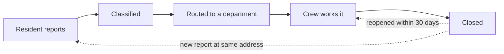

<!--
The long-form explainer behind the home page's one-paragraph pitch.

Opened from the home page and dismissed again without navigating. It exists
because a headline and one paragraph cannot carry a whole business domain, and
a reader who does not already know the industry will otherwise not understand
what any of the agent's answers are for.

It describes the **app**, not the dataset. What ships outward looks like a
dataset with an agent attached, but what a reader actually needs is what the
app is for: whose problem it solves, on what evidence, and how far it goes
today. The first three sections explain the world, the last three explain what
the agent does in it.

Written for a stranger with no domain knowledge and no context about who built
this: the industry, not an employer; the problem, not a project. Common sense
should be enough to follow every sentence.

The title and subtitle above it live in `site.toml` under
`[home.businessContext]`, because they label the control that opens this.

At most one mermaid diagram in the whole file, under ten nodes.
-->

## How a 311 platform makes money

In most North American cities, 311 is the number you call when something needs fixing but nobody is in danger: a pothole, a streetlight that is out, trash that was never picked up, a tree branch across the sidewalk. It is the quieter sibling of 911. Residents now file these reports by phone, website, mobile app, email and social media, and every one of them has to be read, sorted, sent to the right city department, worked by a field crew and closed.

Most mid-sized cities do not build that machinery themselves. They rent it from a software company that runs one platform for many cities at once, each city a separate customer with its own departments, categories and service promises.

- **Subscriptions.** The main revenue line. Each city pays a yearly fee set by its population, typically between a hundred thousand and a million dollars, on contracts of one to three years.
- **Add-on modules.** Optional extras on top of the base platform. The most valuable is an AI module that reads each report and decides its category automatically, which costs almost nothing to run once built and is the main reason customers grow their contracts.
- **Renewals.** The thing everything depends on. Government contracts take a year to win and are hard to leave, but a city that feels badly served will put the contract out to tender when it comes up, often after a new mayor arrives. Losing one large city erases years of growth.

## Where the money quietly leaks

None of the following shows up in the monthly report a city receives. Each one is structural, a consequence of how 311 is normally measured, and each stays invisible unless somebody reads past the structured fields into what residents actually wrote. That is what this agent is for.

- **Reports land in the wrong queue, and the slow one.** When the classifier is unsure, it drops a report into a catch-all Other pile handled by a general queue with a slower deadline. Some of those reports plainly say pothole or streetlight. Nobody notices because the report is still handled eventually, just late, and the late ones count against the city as if the crew had been slow.
- **Emergencies are filed as routine.** Residents pick a severity when they file, and many describe a gas leak or a live wire while choosing medium. The structured field says medium, so the report waits like any other. It only surfaces later, when it is reopened because the first visit did not deal with it.
- **Fast closures hide repairs that did not hold.** Field crews are measured on how quickly they close tickets, so a ticket can be closed after a temporary patch. The report shows on time. A few weeks later the same address files again, as a brand new request, so the original closure never looks like a failure.
- **Residents warn before they escalate.** Complaints to a council member are rare but politically expensive, and they weigh heavily when a contract comes up for renewal. Residents usually say they are about to do it, writing third time or fed up in their report, but no structured field records tone.
- **The classifier is not equally good everywhere.** One model serves every city, and it reads Quebec French or Deep South slang far less accurately than the vocabulary it was trained on. The platform average looks healthy while a handful of cities quietly receive a worse product, and those are the cities at risk of leaving.

## What that looks like in the data

Every one of those leaks leaves a trace, but never in one place. Proving a misroute means putting a report's category next to its text and its SLA outcome. Proving a fast closure did not hold means lining up every report at one address in time order. That is why the record keeps everything about a request together rather than just its final status.

It covers 120 cities over three years: the reports residents filed and the text they wrote, the category the platform recorded and what the classifier guessed, an audited sample where the true category was checked by hand, every status change in each request's life, the work orders and crew notes, the SLA breaches, the complaints that reached city council, and a monthly health summary for every city.

It is a fixed snapshot rather than a live feed. Its "today" is 1 June 2026, which is what makes the same question return the same answer whenever it is asked.

Every question in this app is a question about some step along one path:

## What the agent does with it

You ask in plain English. The agent reads the database structure, works out which tables have to be joined and over what time window, writes the query, runs it, and then explains what came back in operational terms rather than handing you a grid of numbers.

It picks its format to match the question. Exact values arrive as a table. When the shape of the numbers is the point, such as a ranking across cities, a trend across months, or the gap between a reported and a true rate, it draws a chart. When the answer is about how requests flow rather than how many, it draws a diagram.

Every number it reports comes from a query it actually ran against the data, not from its own recollection. If you want to check it, ask it to show you the SQL and the reasoning; it keeps both.

## What you can ask, and how to read the answers

Almost every useful question falls into one of four groups. You do not need to phrase them precisely or know any table names.

- **Routing accuracy.** How many reports in the Other pile mention a clear category, how much slower the general queue is, which cities the classifier reads worst, and whether dialect or city size explains it.
- **Hidden urgency.** How often residents describe an emergency while ticking low or medium, how much more often those reports are reopened, and on which channels the ticked severity is least reliable.
- **True on-time rate.** How often a quick closure is followed by a new report at the same address within 30 days, and how far each city's on-time rate falls once those repeats count as failures.
- **Escalation early warning.** How much more likely a council complaint becomes when a report contains escalation language, which channels those complaints take, and which cities are drifting toward high churn risk.

Two habits make the answers far more useful. First, averages hide the finding: the platform-wide classifier accuracy blends 110 cities where it works with ten where it does not, and looks reassuring either way. Ask for the breakdown by city or by dialect, not the mean.

Second, watch the baseline. One million reports share about 150,000 addresses, so a fair number of addresses see a second report within a month by pure chance. The finding is not that quick closures repeat, it is that they repeat several points more often than everything else. Likewise, the most recent month always looks better than it is, because its slowest requests have not closed yet; the agent uses the last fully settled month for anything described as current.

## Beyond read-only

This app only reads. It can query anything in the record and explain it, but it cannot change a single row. That is a deliberate choice for something anyone can open, not a limitation of what the approach can do.

The same architecture supports the other half. An agent can be given tools that act rather than only report: raise the priority of a report that describes a gas leak, reroute an Other report that clearly names a pothole, open a follow-up inspection when an address files again after a fast closure. The analysis and the action then live in one place, instead of ending in a slide deck that someone has to act on by hand a week later.

That step is only responsible with two things attached. Guardrails: an agent gets narrowly scoped permissions, and the consequential actions need human approval rather than a broad key and good intentions. An auditable trail: every action it takes is attributable, reviewable, and reversible after the fact. An agent that can act without both is not a more capable product, it is an unaccountable one. That is why what you are looking at here stops at read-only.
